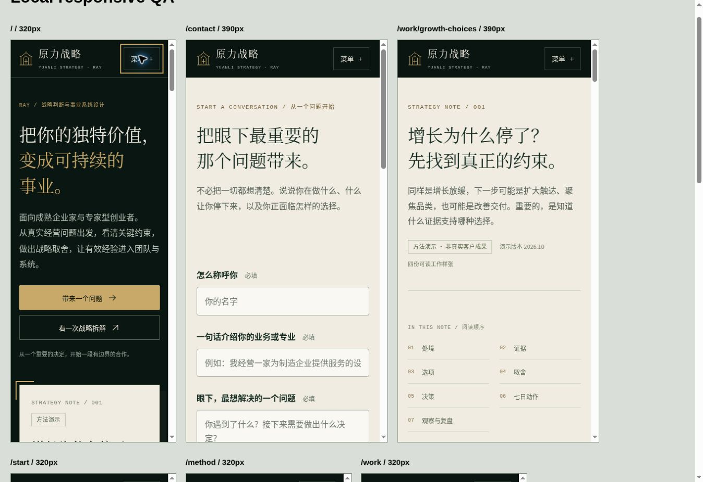

# 首版工程验收记录 · 2026-10-21

规格：[Web #38](https://github.com/moonstachain/yuanli-strategy-web/issues/38)。本记录描述源文件提交前的实际检查；托管部署的版本、数据库回读和访问状态继续写入对应 PR 与 [#44](https://github.com/moonstachain/yuanli-strategy-web/issues/44)。

## 工程行为

- Node 24.19.0 环境运行 TypeScript noEmit 和 8 项 contact 行为测试，全部通过。
- 测试覆盖保存后回执、授权读取、重试不重复、同键不同内容冲突、非法输入和跨源请求、存储失败不报成功、访问默认拒绝、限额与并发重试边界。
- 使用官方 Sites 构建流程生成 Worker 与前端产物，构建成功；发布归档会从最终源码重新构建。
- 本地 D1 首个迁移已应用。浏览器填写合成测试资料，获得回执 `YL-20849e01-d265-46af-9487-4faa8a51967e`，随后直接查询本地数据库找到同一编号。没有发送外部通知。

## 页面观察

- 桌面浏览器打开首页、问题导航与联系页，执行阅读路径生成、主题带入与修改、联系方式切换、同意用途、键盘提交及成功回执。
- 九条内容页面均在 320px 或 390px 的实际 iframe 视窗中渲染。页面根元素 scrollWidth 等于 clientWidth；比较表格在自己的容器内横向滚动。此检查是桌面浏览器窄视窗观察，不是真机或真人试用。
- 手机菜单可展开，Escape 可关闭并恢复按钮焦点；截图保留可见焦点。
- 浏览器联调修正 HTTP 开发预览缺少 crypto.randomUUID 时的提交异常，保留加密随机生成的请求键；修正长篇页的 grid 最小宽度，避免表格撑开整页。
- 页面设置独立标题、说明、canonical、OG 与分享图；当前私密阶段设置 noindex/nofollow，robots 禁止爬取。公开前才调整访问和索引政策。

## 两轴审阅

Standards 和 Spec 由两个独立审阅者检查当前整个新应用（固定基线 ef7f42c 下尚无 business-site/）。截至审阅完成，未发现阻断本次私密首版交付的 P0/P1/P2。四份产物、十二模块、八扇问题门、三种合作方式与 38 个字面内部链接已核对。导航“不确定/跳过”的小缺口已修正。

代码审阅不代替托管环境授权、实际数据库持久化与负责人亲自使用的证据。

## 观察图

## 仍待完成

- #43：跟进状态/下一动作写回，人工承接演练、保留期限与更正删除处理。
- #44：托管部署验证结果回写、实际手机与五名目标访客验收、公开前受众/域名/索引配置。
- 无历史客户成果、真人转化结果或回复时效在本轮被自动验证。
